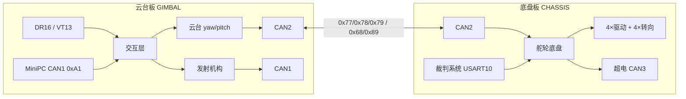

# 征龙凌沧 ZLLC_2027 嵌入式控制框架技术白皮书

| 项目 | 内容 |
| --- | --- |
| 文档版本 | V1.0 |
| 编制日期 | 2026-11-13 |
| 适用固件 | ZLLC_2027（STM32H723VGTx） |
| 代码基线 | 27 赛季定稿 V1.1，2026-10-30 |
| 协议基线 | RoboMaster 2027 通信协议 V1.0.0（20261029）第 1 章 |
| 事实来源 | [README.md](../README.md)、[Referee_2027.md](Referee_2027.md) 及当前源码 |
| 维护团队 | ZLLC（东北大学秦皇岛分校） |

> 本文描述**当前代码已经实现的行为**。凡标注“后续建议”“尚未接入”的内容，均不构成现有框架的能力保证；未经上板验证的结论会明确标注。

---

## 摘要

ZLLC_2027 是一套面向 RoboMaster 2027 赛季、运行于 STM32H723VGTx 的机器人嵌入式控制框架。工程由 2026 赛季裸机框架演进而来，保留 Driver / Device / Algorithm / Chariot / Interaction / Task 的分层结构，并完成三项关键改造：

1. **调度模型任务化**：原 TIM4/TIM5 中断周期业务迁移到原生 FreeRTOS，形成 IMU、Control、Alive、Background 四个固定任务，周期、优先级和栈预算显式化。
2. **数据交接确定化**：UART 接收改为“ISR 复制完整消息入队、控制任务解析”，IMU 与 UI 采用长度 1 的完整快照队列，减少半更新状态被跨上下文读取。
3. **故障恢复集中化**：UART/CAN 错误中断只登记恢复请求，由 1 ms 控制任务统一执行重启、失败重试和诊断计数。

框架以“底盘板 / 云台板”双角色共用一套代码：通过 [config.h](../User/Congfig/Inc/config.h) 的 `CHASSIS` / `GIMBAL` 宏在编译期裁剪整车对象与回调。底盘侧实现四舵轮 AGV 的运动学解算、功率限制与超电协同；云台侧实现 yaw/pitch 双轴稳定、双 pitch、摩擦轮与拨弹控制，并接入 DR16、VT13、MiniPC 三类输入。裁判系统设备层按 2027 新协议重写，支持分片/粘包、CRC 校验、多链路独立缓存及队内交互、小地图、图传自定义数据收发。

在可观测性方面，框架提供统一 DWT 业务时基、可裁剪的性能统计模块、任务栈/堆历史最低余量、控制超周期计数，以及 UART/CAN 恢复诊断；在性能方面启用 I-Cache，并可将 EKF 热点函数放入 ITCM、静态工作区放入 DTCM。当前 D-Cache 尚未开启，CAN 仍在 ISR 直接解析，USB 上位机链路尚未接通，这些边界在本文第 12 章集中说明。

---

## 1. 文档说明

### 1.1 目的

本文用于向新加入的嵌入式成员、算法成员、测试与项目管理成员说明：

- 工程“由哪些层、哪些任务、哪些数据流组成”；
- 一条遥控指令如何经过输入、模式判定、控制解算、总线输出到达执行机构；
- 通信协议、错误恢复、性能统计和构建产物如何协同；
- 哪些能力已经实现、哪些仅通过宿主测试、哪些仍需上板联调。

### 1.2 读者

| 读者 | 建议阅读章节 |
| --- | --- |
| 新加入的嵌入式开发 | 第 2～6 章、第 10～11 章 |
| 控制/算法开发 | 第 5、7、9 章 |
| 测试与联调 | 第 6、8、11、12 章 |
| 项目管理/评审 | 摘要、第 2、12 章 |

### 1.3 术语

| 术语 | 含义 |
| --- | --- |
| 底盘板 / 云台板 | 两块 STM32H723 控制板，分别编译 `CHASSIS`、`GIMBAL` |
| 快照（Snapshot） | 一份完整、不可分割的状态副本，通过长度 1 的覆盖队列交接 |
| 控制任务 | `Task_1ms_Control`，业务状态的主要写入者与控制解算执行者 |
| Alive 任务 | `Task_1ms_Alive`，遥控存活状态机与模块在线扫描 |
| 超周期 | 控制任务单轮工作耗时超过 1 ms 调度周期 |
| TCM | ITCM / DTCM，Cortex-M7 紧耦合存储器 |
| 恢复请求 | ISR 只置位的待恢复标志，由任务上下文执行实际重启 |

### 1.4 事实声明

- 代码版本、任务周期、栈大小、CAN ID、协议字段均取自当前仓库源码。
- 未在当前源码中找到依据的内容，标注为“未在代码中确认”。
- 本文不提供实测耗时、栈余量或 Flash/RAM 占用数字；这些数据必须来自同一次构建的 `.map` 与稳定工况下的 Watch，不能跨构建套用。

---

## 2. 系统总体设计

### 2.1 硬件平台

| 项目 | 配置 |
| --- | --- |
| MCU | STM32H723VGTx，Cortex-M7，主频 480 MHz |
| 指令缓存 | I-Cache 已开启（[main.c](../Core/Src/main.c) `SCB_EnableICache()`） |
| 数据缓存 | D-Cache 未开启 |
| 紧耦合存储 | ITCM 64 KiB、DTCM 128 KiB、AXI SRAM 320 KiB（MDK scatter 声明） |
| 总线 | FDCAN1/2/3、USART1、UART5、UART7/8/9、USART10、SPI2、I2C3（部分预留）、USB CDC |
| 调度内核 | FreeRTOS Kernel V10.3.1，原生抢占式调度 |
| HAL 时基 | TIM6；SysTick 完全交给 FreeRTOS |

### 2.2 双板架构

整车由底盘板与云台板组成，两块板运行同一套代码基，通过 `CHASSIS` / `GIMBAL` 在编译期选择角色。两板之间通过 CAN2 交换控制目标与状态，通过 50 ms 在线计数判断对方是否存活。



| 角色 | 主要职责 | 关键外设 |
| --- | --- | --- |
| `CHASSIS` | 底盘运动学、功率控制、超电、裁判系统、yaw 随动 | CAN1 电机、CAN2 板间与 yaw、CAN3 磁编/超电、USART10 |
| `GIMBAL` | 云台稳定、发射控制、遥控输入、MiniPC 接收 | CAN1 摩擦轮/pitch2/MiniPC、CAN2 yaw/pitch/板间、UART5/USART1 |

### 2.3 软件分层

| 层次 | 路径 | 职责 | 不应放入的内容 |
| --- | --- | --- | --- |
| 生成及板级入口 | `Core/`、`USB_DEVICE/` | 时钟、外设初始化、IRQ、USB HAL | 整车业务判断 |
| Driver | `User/Driver/` | 总线收发、DMA 启动、错误回调与恢复服务 | 协议语义、控制策略 |
| Device | `User/Device/` | 电机/遥控/IMU/裁判/上位机协议解析与设备状态 | 整车模式切换 |
| Algorithm | `User/Algorithm/` | PID、EKF、滤波、矩阵、功率限制等纯计算 | 具体业务流程 |
| Chariot | `User/Chariot/` | 底盘、云台、发射机构的模块级控制 | 遥控输入解释 |
| Interaction | `User/Interaction/` | 输入策略、整车模式、在线保护、板间业务状态 | 底层寄存器操作 |
| Task | `User/Task/` | 对象绑定、任务创建、周期调度、队列与快照 | 具体控制算法 |
| Config / Tools | `User/Congfig/`、`Tools/` | 角色与功能开关、静态检查脚本 | 运行时业务逻辑 |

分工原则：**Device 说明“能做什么”，Interaction 决定“何时做”，Task 决定“在哪个上下文、按什么周期做”**。新增业务不应在 Driver 中堆叠整车判断。

### 2.4 设计原则

1. **执行上下文显式化**：每个函数都应能回答“由哪个任务或哪种中断调用”。
2. **数据所有权明确**：先确定写入者与消费者，再选择消息副本、快照、双缓冲或临界区。
3. **ISR 短小化**：接收中断只做复制、计数和入队；协议解析与控制计算尽量下沉到任务。
4. **恢复任务化**：错误 ISR 只置位请求，不在中断内等待 DMA、总线或 HAL 超时。
5. **可观测优先**：新增周期工作、队列、恢复路径应同时提供计数或耗时测点。
6. **构建一致性**：宏、链接脚本、map 与烧录产物必须来自同一次构建。

---

## 3. 运行时架构

### 3.1 启动流程

```text
main()
  → SCB_EnableICache()
  → HAL_Init() / SystemClock_Config()
  → MX_GPIO/DMA/FDCAN/SPI/TIM/UART/USB 初始化
  → Task_Init()
      → DWT_Init(480)
      → CAN_Init / UART_Init / SPI_Init / USB_Init 注册回调
      → chariot.Init()（设备对象与交互对象绑定）
      → buzzer_setTask()
  → FreeRTOS_Start()
      → 创建控制输入队列、IMU 快照队列、UI 快照队列
      → 创建 4 个业务任务并绑定内存监控
      → vTaskStartScheduler()
```

入口实现见 [main.c](../Core/Src/main.c)、[tsk_config_and_callback.cpp](../User/Task/Src/tsk_config_and_callback.cpp#L541-L602) 与 [freertos_tasks.cpp](../User/Task/Src/freertos_tasks.cpp#L33-L74)。TIM4/TIM5 不再作为周期业务调度器。

### 3.2 FreeRTOS 配置

| 配置项 | 当前值 | 影响 |
| --- | --- | --- |
| `configTICK_RATE_HZ` | 1000 | 1 ms 系统节拍，`pdMS_TO_TICKS(1)=1` |
| `configMAX_PRIORITIES` | 32 | 任务优先级 24～30 |
| `configMINIMAL_STACK_SIZE` | 512 字（2048 B） | 任务栈以 2 KiB 为基数 |
| `configTOTAL_HEAP_SIZE` | 64 KiB（heap_4） | 任务栈、队列、控制块均从此分配 |
| `configUSE_PREEMPTION` | 1 | 抢占式调度 |
| `configCHECK_FOR_STACK_OVERFLOW` | 2 | 栈溢出进入钩子死循环 |
| `configUSE_MALLOC_FAILED_HOOK` | 1 | 堆耗尽进入钩子死循环 |
| `configUSE_TIMERS` | 1 | 软件定时器任务优先级低于业务任务 |
| `configPRIO_BITS` | 4（NVIC Group 4） | 4 位抢占优先级，子优先级为 0 |

配置文件为 [FreeRTOSConfig.h](../User/Task/Inc/FreeRTOSConfig.h)。HAL 时基由 TIM6 提供，避免 SysTick 同时承担 HAL 与 RTOS 节拍。

### 3.3 任务划分

| 任务函数 | FreeRTOS 名称 | 周期 | 优先级 | 栈 | 主要工作 |
| --- | --- | --- | --- | --- | --- |
| `Task_100us_Fast` | `TaskIMU` | 1 ms | 30 | 2048 B | IMU 采样、姿态解算、发布完整快照 |
| `Task_1ms_Control` | `TaskControl` | 1 ms | 27 | 4096 B | 应用 IMU 快照、处理输入、通信恢复、控制解算、板间打包、UI 快照 |
| `Task_1ms_Alive` | `TaskAlive` | 1 ms | 25 | 2048 B | 遥控存活状态机；每 50 ms 触发模块在线扫描 |
| `Task_Background` | `TaskBkgnd` | 每轮后延时 50 ms | 24 | 4096 B | UI 绘制、后台工作、低频内存诊断 |

优先级宏定义在 [priority_config.h](../User/Task/Inc/priority_config.h#L30-L36)：`IMU = configMAX_PRIORITIES-2`、`Control = -5`、`Timer = -6`、`Alive = -7`、`Background = -8`。**数值越大越优先**；NVIC 则相反，数值越小越优先，两套语义不可混用。

`Task_100us_Fast` 是历史命名，实际周期为 1 ms，新接口不应沿用该名称。

### 3.4 控制任务节拍

```text
每 1 ms：
  vTaskDelayUntil
  ├─ 应用最新 IMU 快照（xQueueReceive 非阻塞）
  ├─ 处理控制输入（最多 64 条）
  ├─ 启动等待计数（约 2000 个周期，约 2 s）
  ├─ UART_Error_Service / Referee_DMA_Service / CAN_Error_Service
  ├─ 在线状态对应的模式保护
  ├─ 每 2 ms：模块控制解算 TIM_Calculate_PeriodElapsedCallback
  ├─ 每 2 ms：TIM_CAN_PeriodElapsedCallback（内部再分频）
  ├─ 每 10 ms：板间数据打包
  ├─ 每 50 ms：发布 UI 快照
  └─ 统计本周期是否超时
```

关键点：

- 启动后约 2 s 内只执行通信恢复、在线保护和计数，不执行控制解算。
- 控制解算按 2 ms 分频；板间打包 10 ms；UI 快照 50 ms。
- 遥控策略 `TIM_Control_Callback()` 由**有效 DR16/VT13 帧**触发，不是每 1 ms 都执行 `Control_Gimbal()`。修改调用位置时必须区分“输入事件”和“周期计算”。

### 3.5 中断优先级

| 用途 | 宏 | NVIC 抢占优先级 |
| --- | --- | --- |
| HAL 时基 TIM6 | `ROBOT_IRQ_PRIORITY_HAL_TICK` | 4 |
| FreeRTOS API 阈值 | `ROBOT_IRQ_PRIORITY_RTOS_API_MIN` | 5 |
| 传感器 / CAN | `ROBOT_IRQ_PRIORITY_SENSOR` / `CAN` | 5 |
| 遥控接收（UART5/USART1） | `ROBOT_IRQ_PRIORITY_CONTROL_RX` | 6 |
| 其他串口 / 裁判系统 | `ROBOT_IRQ_PRIORITY_COMM_RX` | 7 |
| USB | `ROBOT_IRQ_PRIORITY_USB` | 8 |
| UART 发送 | `ROBOT_IRQ_PRIORITY_UART_TX` | 9 |
| 内核 PendSV/SysTick | `ROBOT_IRQ_PRIORITY_KERNEL` | 15 |

调用 `FromISR` API 的中断，其 NVIC 数值必须 **≥ 5**；高于该阈值的中断只能执行不依赖 RTOS 的工作。

### 3.6 数据交接模型

| 数据 | 生产者 | 交接方式 | 消费者 | 约束 |
| --- | --- | --- | --- | --- |
| UART 接收 | UART DMA IDLE/错误 ISR | 完整消息副本 → `xQueue_Control_Rx` | 控制任务 | 队列深度 128，每轮最多 64 条，满队列丢帧并计数 |
| CAN 接收 | CAN RX ISR | 当前直接在 ISR 解析 | 设备/业务对象 | 延迟低，但非任务化；一次回调只读一帧 |
| IMU 状态 | IMU 任务 | 长度 1 覆盖队列 `xQueue_IMU_Snapshot` | 控制任务 | IMU 独占 `INS`/EKF 工作态，控制侧持有副本 |
| UI 数据 | 控制任务 | 长度 1 覆盖队列 `xQueue_UI_Snapshot` | Background 任务 | 后台不直接读 `chariot` 或 `start_flag` |
| 在线状态 | Alive 任务 | 短临界区直接更新共享对象 | 控制任务/业务 | Alive 优先级必须低于 Control |
| 板间控制 | 控制任务 | 静态发送缓冲 + CAN 驱动分频 | 对方板 | 缓冲仅由控制任务写 |

`xQueueOverwrite` 只保留最新状态，不承担逐帧日志职责。`volatile` 不能替代互斥、完整快照或 Cache 维护。

---

## 4. 软件架构与模块

### 4.1 对象组合

交互层核心对象为 `Class_Chariot`（[ita_chariot.h](../User/Interaction/Inc/ita_chariot.h#L209-L246)），按角色聚合：

| 角色 | 成员对象 | 说明 |
| --- | --- | --- |
| 公共 | `Referee`、`Chassis` | 裁判系统、底盘 |
| CHASSIS | `Motor_Yaw`、`PID_Chassis_Follow`、`Boardc_BMI` | yaw 随动、随动 PID、IMU |
| GIMBAL | `DR16`、`VT13`、`MiniPC`、`Gimbal`、`Booster` | 遥控、上位机、云台、发射 |
| GIMBAL | `FSM_Alive_Control`、`FSM_Alive_Control_VT13` | 两路遥控离线保护状态机 |

初始化顺序见 [ita_chariot.cpp](../User/Interaction/Src/ita_chariot.cpp#L36-L101)：底盘侧先 IMU、裁判、底盘、随动 PID、yaw 电机、超电；云台侧先离线状态机、遥控器、云台、发射、MiniPC，最后启动 TIM12 PWM 与蜂鸣器。

对象按生命周期分为三类：

- **专属对象**：只属于一个上层对象，直接封装并初始化（如底盘内的功率限制）。
- **同类可复用对象**：同类多实例，由最近的上层专属对象持有（如四个驱动电机）。
- **通用对象**：多个上层共享，以指针注入（如 `Referee`、`IMU`、`MiniPC`）。

### 4.2 Driver 层

| 模块 | 关键接口/变量 | 说明 |
| --- | --- | --- |
| `drv_can` | `CAN_Init`、`CAN_Send_Data`、`CAN_Error_Service`、`CAN*_Recovery_Diagnostics` | 三路 FDCAN；回调注册；Bus-Off/严重错误恢复 |
| `drv_uart` | `UART_Init`、`UART_Send_Data`、`UART_Error_Service`、`UART*_Recovery_Diagnostics` | DMA + IDLE 接收；USART1/UART5/USART10 统一恢复 |
| `drv_spi` | `SPI_Init` | SPI2 用于板载 BMI088 |
| `drv_i2c` | `IIC_Init` | 预留，当前云台侧磁力计未启用 |
| `drv_usb` | `USB_Init` | CDC 接口存在，业务回调尚未接通 |
| `drv_dwt` | `DWT_Init(480)` | 硬件周期计数器，业务时基 |
| `drv_tim` | `TIM_Init` 等 | PWM/定时器基础配置 |
| `drv_math` | 映射、限幅、角度归一化 | 通用数学工具 |

### 4.3 Device 层

| 设备模块 | 接入方式 | 主要职责 |
| --- | --- | --- |
| `dvc_boardc_bmi088` / `dvc_imu` | SPI2 | BMI088 采样、温度补偿、姿态解算、快照导出 |
| `dvc_djimotor` | CAN | DJI C620/M2006/M3508 反馈解析、电流/电压/角度控制 |
| `dvc_dmmotor` | CAN | 达妙 DM 系列电机（Pitch 等） |
| `dvc_lkmotor` | CAN | 瓴控 LK 电机（Yaw），支持 IMU 角度/力矩模式 |
| `dvc_dr16` | UART5 | DR16 遥控器 18 字节帧、通道/拨杆/键鼠解析 |
| `dvc_VT13` | USART1 | VT13 遥控器 21 字节帧解析 |
| `dvc_minipc` | CAN1（0xA1） | 上位机自瞄角度、模式与状态；USB 接口预留 |
| `dvc_supercap` | CAN3（0x67/0x66） | 超电电压、电流、功率、电量与使能控制 |
| `dvc_referee` | USART10 等 | 2027 裁判协议解析、发送队列、多链路缓存 |
| `dvc_GraphicsSendTask` | 裁判发送队列 | 赛场 UI 图形绘制与刷新 |
| `dvc_TensionMeter` | 预留 | 拉力计数据 |
| `buzzer` | TIM12 PWM | 开机、校准、离线等提示音 |

### 4.4 Algorithm 层

| 模块 | 用途 | 当前调用位置 |
| --- | --- | --- |
| `alg_pid` / `PID` | 位置式/增量式 PID、限幅、死区 | 底盘速度环、云台角度环、随动环 |
| `QuaternionEKF` | 四元数扩展卡尔曼姿态估计 | IMU 解算 |
| `kalman_filter` | 线性卡尔曼滤波 | 底盘速度估计 |
| `alg_MahonyAHRS` | Mahony 姿态解算 | 备用/对比路径 |
| `alg_filter` | 多种数字滤波器 | IMU、yaw 角度、电流等 |
| `alg_slope` | 斜坡加减速 | 底盘速度/角速度目标 |
| `alg_new_power_limit` | 功率模型与分配 | 底盘功率限制 |
| `alg_power_limit` | 旧版功率限制 | 保留实现，当前主链路使用新版 |
| `alg_fsm` | 有限状态机基类 | 离线保护、热量检测、卡弹策略 |
| `Matrix` / `RLS` | 矩阵运算、递推最小二乘 | 算法库；RLS 在当前主控制链路的调用未在代码中确认 |

### 4.5 Chariot 层

| 模块 | 核心类 | 职责 |
| --- | --- | --- |
| 底盘 | `Class_Steering_Wheel_Chassis` | 四舵轮运动学、速度估计、PID、功率分配、超电 |
| 云台 | `Class_Gimbal` | yaw/pitch 双轴稳定、双 pitch、角度限幅、折叠 |
| 发射 | `Class_Booster` | 摩擦轮、拨弹、热量检测 FSM、卡弹处理 FSM |

### 4.6 Interaction 层

`Class_Chariot` 的定时接口分工如下：

| 接口 | 调用上下文 | 周期 | 工作 |
| --- | --- | --- | --- |
| `TIM_Control_Callback()` | 控制任务，有效遥控帧 | 事件驱动 | 判定输入来源，执行底盘/云台/发射策略 |
| `TIM_Calculate_PeriodElapsedCallback()` | 控制任务 | 2 ms | 模块控制解算与输出 |
| `TIM50ms_Alive_PeriodElapsedCallback()` | Alive 任务 | 50 ms（内部 3/7/20 分频） | 电机、超电、裁判、遥控、MiniPC 在线扫描 |
| `TIM_Alive_Protect_PeriodElapsedCallback()` | 控制任务 | 1 ms | 根据在线状态禁用底盘等保护动作 |
| `TIM1msMod50_*_Communicate_Alive_*` | Alive 任务 | 150 ms | 板间在线计数比较 |

### 4.7 Task 层

| 文件 | 职责 |
| --- | --- |
| [freertos_tasks.cpp](../User/Task/Src/freertos_tasks.cpp) | 队列/任务创建、控制输入分派、四个任务主循环 |
| [tsk_config_and_callback.cpp](../User/Task/Src/tsk_config_and_callback.cpp) | 对象定义、CAN/UART/SPI 回调、周期回调、初始化 |
| [priority_config.h](../User/Task/Inc/priority_config.h) | IRQ 与任务优先级、编译期一致性检查 |
| [FreeRTOSConfig.h](../User/Task/Inc/FreeRTOSConfig.h) | 内核配置、堆、断言与钩子 |

---

## 5. 控制链路

### 5.1 底盘（四舵轮 AGV）

底盘采用 4 组“驱动 + 转向”舵轮，轮组编号与建系如下：

```text
      ↑ y
      │
      └────→ x

   1   2
   4   3
```

关键常量（[crt_chassis.h](../User/Chariot/Inc/crt_chassis.h#L43-L59)）：

| 常量 | 值 | 含义 |
| --- | --- | --- |
| `wheel_diameter` | 0.12 m | 驱动轮直径 |
| `half_length` | 0.178 m | 轮距一半 |
| `R_DIST` | `half_length × √2` | 旋转中心到舵轮距离 |
| `Wheel_Azimuth[4]` | `3π/4, -3π/4, -π/4, π/4` | 四轮安装方位角 |
| 驱动电机 | 4 × C620 | CAN1 `0x201/0x203/0x205/0x207` |
| 转向电机 | 4 × C620 Steer | CAN1 `0x202/0x204/0x206/0x208` |

控制链路：

```text
遥控/板间目标速度 (vx, vy, ω)
  → 斜坡限幅（Slope_Velocity_X/Y、Slope_Omega）
  → 舵轮运动学逆解（轮速 + 舵角）
  → 舵角就近化/限幅 + 驱动轮速度 PID
  → 功率限制分配（转向功率占比 0.5，可调）
  → CAN 电流/电压指令
```

底盘控制类型（`Enum_Chassis_Control_Type`）：

| 模式 | 行为 |
| --- | --- |
| `DISABLE` | 输出清零，电机失能 |
| `FLLOW` | 跟随云台坐标系移动 |
| `SPIN_Positive` | 小陀螺，附加旋转角速度 |
| `Drive` | 直驱模式，按目标角速度控制 |

其他要点：

- 底盘速度估计使用 `Chassis_Speed_Kalman` 与 `Chassis_Speed_Estimate()`，测点 `Chassis_Speed_Estimate_Timing`。
- 功率限制由 `Class_Power_Limit`（`alg_new_power_limit`）执行，结合裁判系统功率/缓冲能量与超电状态。
- 超电通过 CAN3 接入：接收 `0x67`，发送 `0x66`（50 ms 分频）。
- yaw 电机编码器用于云台/底盘坐标系转换（`Reference_Angle = -52.29°`，可在 [config.h](../User/Congfig/Inc/config.h#L48-L50) 标定）。
- 整车初始化将 X/Y 最大速度设为 4.0 m/s（[ita_chariot.cpp](../User/Interaction/Src/ita_chariot.cpp#L61-L67)）。

### 5.2 云台

| 轴/机构 | 电机 | 总线与 ID | 说明 |
| --- | --- | --- | --- |
| Yaw | LK 电机 | CAN2 `0x141` | 接收反馈；控制指令同 ID 发送 |
| Pitch | DM4310 | CAN2 `0xA1` | 主 pitch |
| Pitch2 | DM 电机 | CAN1 `0xA2` | 第二 pitch / 折叠机构 |
| 摩擦轮左/右/下 | DJI 电机 | CAN1 `0x201/0x202/0x203` | 发射 |
| 拨弹驱动 | DJI 电机 | CAN2 `0x204` | 拨盘 |
| MiniPC | CAN1 `0xA1` | 6 字节 | `alive:u8, Fire:u8, yaw:int16, pitch:int16`，弧度×10000 |

云台控制类型：

| 模式 | 行为 |
| --- | --- |
| `DISABLE` | PID 清零、输出失能 |
| `NORMAL` | 遥控/键鼠控制，IMU 稳定 |
| `MINIPC` | 采用上位机角度，需在线且 `alive != 0` |
| `FOLD` | 折叠/收纳姿态 |

控制特性：

- Pitch 支持重力补偿与角度限幅；yaw 处理 ±180° 边界与多圈连续化。
- `Gimbal_FSM` 提供松弛、初始化、自稳、跟随、校准、安全六种内部模式（当前主链路以控制类型为主）。
- MiniPC 角度只在 `Gimbal_Control_Type_MINIPC`、通信在线、`alive != 0` 同时成立时采用。
- 云台板通过 CAN2 `0x68/0x89` 接收底盘状态，通过 `0x77/0x78/0x79` 向底盘发送目标与模式。

### 5.3 发射机构

`Class_Booster` 包含：

- 摩擦轮控制（左/右/下三路，可独立使能）；
- 拨弹电机控制（单发、连发、多发、停火）；
- **热量检测 FSM**：根据摩擦轮扭矩判断“发射嫌疑/完成”，累加热量并按裁判冷却值递减；
- **卡弹处理 FSM**：根据拨弹盘扭矩判断卡弹嫌疑、回拨、超时失能；
- 裁判热量上限、冷却值、弹速等状态由底盘板通过 CAN 同步。

控制类型：`DISABLE`、`CEASEFIRE`、`SINGLE`、`REPEATED`、`MULTI`。

### 5.4 整车模式与输入

| 输入 | 解析 | 作用 |
| --- | --- | --- |
| DR16 | UART5，18 字节 | 遥控通道、拨杆、键鼠 |
| VT13 | USART1，21 字节 | 遥控通道、拨杆、键鼠 |
| MiniPC | CAN1 `0xA1` | 自瞄 yaw/pitch、开火、存活 |
| 板间 CAN | CAN2 | 底盘/云台目标与模式同步 |

交互层维护：

- `Active_Controller`：`NONE / DR16 / VT13`，决定当前有效输入；
- `DR16_Control_Type`、`VT13_Control_Type`：遥控或键鼠；
- 整车状态：`Sprint_Status`、`Bulletcap_Status`、`Fric_Status`、`MiniPC_Aim_Status`、`Referee_UI_Refresh_Status`；
- 离线保护 FSM：按 `elapsed_ms` 累计超时，约 1 s 进入保护，清零输入/积分并切换模式。

---

## 6. 通信架构

### 6.1 UART

| 串口 | 用途 | 波特率/格式 | 缓冲 | 恢复 |
| --- | --- | --- | --- | --- |
| USART10 | 裁判系统常规链路（CHASSIS） | 115200、8N1 | 128 B | 是 |
| UART5 | DR16（GIMBAL） | 按 DR16 配置 | 18 B | 是 |
| USART1 | VT13（GIMBAL） | 按 VT13 配置 | 60 B | 是 |
| UART7/8/9 | 预留 | — | 128 B | 否 |
| USB CDC | 上位机（预留） | — | 48 B 消息 | 未接通 |

接收链路：DMA + IDLE → ISR 复制完整消息 → `xQueue_Control_Rx` → 控制任务分派 → 设备回调。DR16 保留 18 字节帧长检查和 IDLE 边界同步。

### 6.2 CAN 接收矩阵

**底盘板（CHASSIS）**

| 总线 | ID | 来源 | 含义 |
| --- | --- | --- | --- |
| CAN1 | `0x201/0x203/0x205/0x207` | 驱动电机 | 四轮反馈 |
| CAN1 | `0x202/0x204/0x206/0x208` | 转向电机 | 四舵反馈 |
| CAN2 | `0x77/0x78/0x79` | 云台板 | 速度目标、模式字节、H7 偏移 |
| CAN2 | `0x141` | yaw 电机 | 角度/速度/扭矩反馈 |
| CAN3 | `0xD1～0xD4` | MA600 磁编 | 四舵绝对角度 |
| CAN3 | `0x67` | 超电 | 电压、电流、功率、电量 |

**云台板（GIMBAL）**

| 总线 | ID | 来源 | 含义 |
| --- | --- | --- | --- |
| CAN1 | `0x201/0x202/0x203` | 摩擦轮 | 左/右/下反馈 |
| CAN1 | `0xA1` | MiniPC | 自瞄角度与开火 |
| CAN1 | `0xA2` | Pitch2 | 第二 pitch 反馈 |
| CAN2 | `0x141` | Yaw 电机 | 反馈 |
| CAN2 | `0xA1` | Pitch 电机 | 反馈 |
| CAN2 | `0x204` | 拨弹电机 | 反馈 |
| CAN2 | `0x68/0x89` | 底盘板 | 裁判热量、ID、比赛阶段、弹速等 |
| CAN3 | — | 预留 | 当前无有效分支（DM IMU 分支已注释） |

### 6.3 CAN 发送调度

`TIM_CAN_PeriodElapsedCallback()` 由控制任务每 1 ms 调用，再按计数分频：

**底盘板**

| 周期 | 报文 |
| --- | --- |
| 2 ms | CAN1 `0x200`（四驱动电流）、`0x1ff`（四舵电流） |
| 10 ms | CAN2 `0x68/0x89`（底盘 → 云台） |
| 20 ms | CAN3 `0x66`（超电控制） |

**云台板**

| 周期 | 报文 |
| --- | --- |
| 1 ms | CAN2 `0x141`（yaw 控制） |
| 2 ms | CAN2 `0xf1`、CAN1 `0xa0`（MiniPC 反馈） |
| 5 ms | CAN2 `0x77/0x78/0x79`（云台 → 底盘）、CAN1/CAN2 `0x200`（摩擦轮/拨弹） |

> 代码注释中出现过“250Hz”等旧标注，实际周期以分频计数为准；修改调度时应同步更新注释。

### 6.4 板间通信

| 方向 | ID | 周期 | 主要内容 |
| --- | --- | --- | --- |
| 云台 → 底盘 | `0x77` | 5 ms | 目标 vx/vy/ω、pitch 角度（int16 映射） |
| 云台 → 底盘 | `0x78` | 5 ms | 底盘/云台/发射模式、冲刺、摩擦轮、MiniPC、UI 刷新位 |
| 云台 → 底盘 | `0x79` | 5 ms | H7 偏移 X/Y（float） |
| 底盘 → 云台 | `0x68` | 10 ms | 机器人 ID、比赛阶段、热量上限、冷却、当前热量 |
| 底盘 → 云台 | `0x89` | 10 ms | 弹速（×10，uint16） |

在线判定：每收到一帧板间消息递增 `Gimbal_Alive_Flag` / `Chassis_Alive_Flag`，Alive 任务每 150 ms 比较一次；计数不变化则对方离线，云台侧触发蜂鸣器提示，底盘侧在 yaw 或云台离线时禁用底盘控制。

### 6.5 MiniPC

- 物理链路：云台板 CAN1，标准 ID `0xA1`，6 字节。
- 字段：`alive:uint8`、`Fire:uint8`、`yaw:int16`、`pitch:int16`；角度 = 弧度 × 10000。
- 使用条件：`MINIPC` 模式 && 通信在线 && `alive != 0`。
- 反馈：云台板 CAN1 `0xa0`，2 ms 分频。
- USB CDC 接口保留，但当前 `MiniPC_USB_Callback` 为空，不能据此使用 USB 自瞄。

### 6.6 裁判系统 2027

设备层实现位于 [dvc_referee.h](../User/Device/Inc/dvc_referee.h) / [dvc_referee.cpp](../User/Device/Src/dvc_referee.cpp)，详细接口见 [Referee_2027.md](Referee_2027.md)。

| 链路 | 入口 | 当前接入 |
| --- | --- | --- |
| 常规裁判链路 | `UART_RxCpltCallback` | CHASSIS USART10，115200、8N1 |
| 图传自定义控制 | `Video_UART_RxCpltCallback`（`0x0311`） | 接口已提供，物理 UART 需另行配置 921600 |
| 雷达无线 | `Wireless_RxCpltCallback`（`0x0A01..0x0A06`） | 接口已提供，需外部解调 |

接收器特性：

- 按 `0xA5` 帧格式处理连续字节流，支持分片与粘包；
- 校验 CRC8、CRC16、命令所属链路与数据长度；
- 错误后重新搜索帧头，三条链路各自保存未完成帧；
- 只有收到有效协议帧才更新在线检测依据。

发送接口均返回 `bool`，`true` 仅表示本地队列或 DMA 已接受：

| 接口 | 命令 | 频率限制 |
| --- | --- | --- |
| `Send_Interaction` | `0x0301` | 所有 `0301` 子内容共用 ≥34 ms |
| `Send_Sentry_Command` | `0301/0120` | 仅 7/107 |
| `Send_Radar_Command` | `0301/0121` | 仅 9/109 |
| `Send_Map_Position` | `0x0305` | ≥200 ms，仅雷达 |
| `Send_Map_Path` | `0x0307` | ≥1000 ms |
| `Send_Map_Robot_Data` | `0x0308` | ≥334 ms |
| `Send_Custom_Data` | `0x0310` | ≥20 ms，图传专用 |

常规发送与 UI 共用一个有界、复制数据的 DMA 队列，由 `Referee_DMA_Service()` 在 1 ms 控制回调中推进；`0x0310` 使用独立的 309 字节整帧 DMA 缓冲。

---

## 7. 状态估计与算法

### 7.1 IMU 与姿态估计

- BMI088 通过 SPI2 采样，IMU 任务独占采样、温补、解算与快照导出。
- `QuaternionEKF` 提供四元数 EKF；`kalman_filter` 用于底盘速度估计；`alg_MahonyAHRS` 为备用姿态路径。
- `EKF_USE_TCM=1` 时，EKF 热点函数进入 `.itcm_ekf`，静态工作区进入 `.bss.dtcm_ekf`；当前静态池只支持一个 `6/0/3` 维度 owner。
- IMU 任务发布 `Struct_IMU_Snapshot`，控制任务每周期 `Apply_Snapshot` 后，业务 getter 读取消费副本。

### 7.2 控制算法

| 算法 | 作用 | 注意点 |
| --- | --- | --- |
| PID | 速度环、角度环、随动环 | 输出限幅、积分分离、微分滤波需与周期匹配 |
| 斜坡 | 目标速度/角速度平滑 | 改变周期会改变实际加减速度 |
| 卡尔曼 | 底盘速度融合 | 观测噪声与模型参数需按实车标定 |
| 功率限制 | 依据功率模型分配驱动/转向功率 | 需与裁判功率、超电状态一致 |
| FSM | 离线保护、热量、卡弹 | 状态驻留时间按 `elapsed_ms` 累计，不按调用次数 |
| 滤波 | IMU、yaw、电流 | 截止频率与采样周期相关 |

### 7.3 时间与单位约定

- 对外接口在参数名中写出单位：`elapsed_ms`、`yaw_deg`、`pitch_rad`、`velocity_mps`。
- 电机反馈角度、IMU 角度、CAN 映射角度必须在接口处说明是度还是弧度。
- 状态机超时使用毫秒累计，避免修改任务周期后超时成倍放大。

---

## 8. 可靠性与故障恢复

### 8.1 启动保护

- 上电后约 2 s 内不执行控制解算，仅进行通信恢复、在线保护和计数。
- `configASSERT` 覆盖队列创建、任务创建、快照发布等关键失败点；断言失败关中断死循环。
- 栈溢出与堆分配失败钩子同样关中断死循环，便于调试器定位。

### 8.2 UART 恢复

- USART1、UART5、USART10 统一由 `UART_Error_Service()` 在 1 ms 控制任务中恢复。
- 错误 ISR 只设置 `Rx_Restart_Pending` / `Tx_Restart_Pending`。
- 恢复流程先异步终止，再重启接收；处理 DMA ERROR 与发送残留状态。
- 诊断变量：`Error_Events`、`Recovery_Count`、`Restart_Failures`、`Last_Error`、`Last_Start_Status`、待恢复标志。
- UART7/8/9 尚未纳入统一恢复流程。

### 8.3 CAN 恢复

- 三路 CAN 由 `CAN_Error_Service()` 分路处理 Bus-Off 与严重 RAM 错误。
- 失败后每 100 ms 重试；一般 FIFO 满/空不触发重初始化。
- 诊断变量：`BusOff_Events`、`Restart_Attempts`、`Restart_Successes`、`Restart_Failures`、`Recovery_Pending`。
- `Restart_Successes` 只表示 HAL 接受重启，物理总线仍需完成同步。
- 当前 `AutoRetransmission` 关闭；报文自动重传与故障恢复是不同机制。

### 8.4 在线检测与模式保护

- Alive 任务每 1 ms 推进遥控存活状态机，按实际 `elapsed_ms` 累计约 1 s 超时。
- 每 50 ms 触发模块扫描，内部保留 3/7/20 次分频，对应 150/350/1000 ms 窗口。
- 扫描会清遥控输入、PID 积分并改变模式，因此必须使用短临界区，且不能加入延时、阻塞收发或复杂计算。
- 底盘侧：yaw 电机或云台离线时禁用底盘；云台侧：底盘离线时触发提示并禁用相关控制。

### 8.5 队列与丢帧

- 控制输入队列深度 128，每轮最多处理 64 条；持续来包不会使控制循环无法结束。
- 队列满时 ISR 投递失败并递增 `ulUART_RxDropped` / `ulUSB_RxDropped`。
- `ulCAN_RxDropped` 来自当前未使用的 CAN 队列路径，不能当作 CAN ISR 的完整丢帧指标。

### 8.6 当前可靠性边界

| 项目 | 现状 | 风险 |
| --- | --- | --- |
| 独立看门狗 | 未启用（`HAL_IWDG_MODULE_ENABLED` 未打开） | 任务死锁只能靠调试器发现 |
| CAN 接收 | ISR 直接解析，一次回调只读一帧 | 未检查 `HAL_FDCAN_GetRxMessage()` 返回值；FIFO 积压策略缺失 |
| USB | CDC 初始化存在，回调为空 | 不能作为有效上位机入口 |
| D-Cache | 未开启 | 通信缓冲尚未做缓存一致性改造 |
| UART7/8/9 | 未纳入恢复 | 异常后可能长期失联 |
| 图传/雷达 | 解析接口已提供 | 物理端口与解调尚未联调 |

---

## 9. 性能工程与可观测性

### 9.1 业务时基

| API | 单位/说明 |
| --- | --- |
| `DWT_GetDeltaT(&last_cycle)` | 秒，float；每个调用点独立计数 |
| `DWT_GetDeltaT64(&last_cycle)` | double 秒，但仍使用 32 位周期差 |
| `DWT_GetTimeline_s/ms()` | float 系统时间线 |
| `DWT_GetTimeline_us()` | uint64 微秒时间线 |
| `DWT_Delay(seconds)` | 忙等，仅用于极短硬件时序 |

480 MHz 下 `CYCCNT` 约 8.95 s 回绕，32 位差值只支持一圈以内。不要为测时重新 `DWT_Init()` 或清零 `CYCCNT`，否则会破坏 PID/EKF 时间基准。

### 9.2 性能统计模块

- `PERFORMANCE_TEST_ENABLE=1` 时启用耗时、频率、栈/堆统计；`0` 时完全移除插桩，但业务时基、调度、恢复不受影响。
- 新增测点：在 `dvc_performance.h` 声明、`dvc_performance.cpp` 定义，并在业务位置使用 `PERF_EVENT` / `PERF_START` / `PERF_STOP`。
- 每个统计对象只能由一个任务或一种中断写入；`START/STOP` 必须在同一作用域，中间不能提前 `return`。
- 耗时包含抢占；外层测量包含内层统计开销。

### 9.3 常用 Watch 对象

| 对象 | 观察内容 |
| --- | --- |
| `Control_Timing` | 控制任务一轮工作（不含周期等待） |
| `IMU_Task_Timing` / `EKF_Timing` | IMU 采样解算与快照发布 / EKF 更新 |
| `Alive_Timing` | 存活状态机与到期模块扫描 |
| `Background_Timing` | 后台业务工作（不含延时与内存采样） |
| `Chassis_Speed_Estimate_Timing` | 底盘速度估计 |
| `Control_Frequency` / `IMU_Frequency` / `Alive_Frequency` | 任务频率，正常约 1000 Hz |
| `Background_Frequency` / `Chassis_UI_Frequency` | 后台循环与实际绘图频率 |
| `CAN_Yaw_Rx_Frequency` / `CAN_Pitch_Rx_Frequency` | 云台 CAN 有效反馈 |
| `CAN_Gimbal_Rx_Frequency` | 底盘 CAN2 板间消息 |
| `Referee_Rx_Frequency` / `Referee_Tx_Frequency` | 裁判接收/发送完成 |
| `MiniPC_Tx_Frequency` | 上位机打包频率（不代表物理发送完成） |
| `ulControl_DeadlineMissed` | 控制任务超周期累计次数 |

### 9.4 栈、堆与内存诊断

Watch 添加 `RTOS_Memory`：

| 字段 | 含义 |
| --- | --- |
| `imu_stack_min_free_bytes` | IMU 栈历史最小剩余（总 2048 B） |
| `control_stack_min_free_bytes` | Control 栈历史最小剩余（总 4096 B） |
| `alive_stack_min_free_bytes` | Alive 栈历史最小剩余（总 2048 B） |
| `background_stack_min_free_bytes` | Background 栈历史最小剩余（总 4096 B） |
| `heap_free_bytes` / `heap_min_free_bytes` | 64 KiB FreeRTOS heap_4 当前/历史最小空闲 |
| `sample_count` / `timestamp_ms` | 采样次数与最近时间 |

估算历史最高栈用量：`分配字节数 - 历史最小剩余字节数`。该值不覆盖未执行路径、栈预留空隙和中断 MSP 栈。栈/堆历史最低值不随耗时对象 `reset_requested` 清零，完整新一轮需重启固件。

### 9.5 缓存与 TCM

- I-Cache 已开启，普通 Flash 函数由硬件自动缓存，不需要逐个把 PID/业务函数“加入 Cache”。
- ITCM/DTCM 是实际 RAM，需要段属性、链接器与 startup 共同配合。
- [ekf_tcm.h](../User/Algorithm/Inc/ekf_tcm.h) 将选定代码标为 `.itcm_ekf`，工作区标为 `.bss.dtcm_ekf`。
- TCM 函数调用的外部 HAL/PID 不会自动迁入 ITCM；结构体指针不会带走所指数组。
- DMA1/2 不能访问 DTCM；开启 D-Cache 前必须明确可达 SRAM、32 B 缓存行独占和 CPU/DMA 所有权。

---

## 10. 构建、烧录与交付

### 10.1 角色选择

在 [config.h](../User/Congfig/Inc/config.h#L44-L46) 中每次只启用一个：

```c
#define CHASSIS
//#define GIMBAL
```

切换角色或修改 `PERFORMANCE_TEST_ENABLE`、`EKF_USE_TCM` 后必须重新编译；烧录、调试和 map 分析应使用同一次构建产物。

### 10.2 构建入口

| 入口 | 配置文件 | 链接脚本 | 输出 |
| --- | --- | --- | --- |
| Keil uVision | [ZLLC_2027.uvprojx](../MDK-ARM/ZLLC_2027.uvprojx) | `MDK-ARM/ekf_tcm.sct` | `MDK-ARM/output/` |
| MDK 目录 EIDE | [eide.yml](../MDK-ARM/.eide/eide.yml) | `ekf_tcm.sct` | 以目标配置为准 |
| 根目录 EIDE | [eide.yml](../.eide/eide.yml) | 未启用自定义 scatter | 常见 `build/ZLLC_2027/` |
| Makefile / GCC | `Makefile`、`STM32H723VGTx_FLASH.ld` | GNU `.ld` | 由构建命令决定 |

重要约束：

- 根 EIDE 当前 `scatterFilePath` 为空，不能直接认定与 MDK 的 TCM 布局相同。
- 不同输出目录的 `.map/.axf` 可能属于不同角色、不同时间或不同链接布局，不能交叉解释板上行为。
- 宏为 1 只说明选择了代码路径，TCM 实际地址必须查看本次 map。

### 10.3 编译宏

| 宏 | 默认 | 作用 |
| --- | --- | --- |
| `CHASSIS` / `GIMBAL` | 二选一 | 角色裁剪 |
| `PERFORMANCE_TEST_ENABLE` | 1 | 性能统计插桩 |
| `EKF_USE_TCM` | 1 | EKF 的 ITCM/DTCM 路径 |
| `POWER_CONTROL` | 0 | 功率控制启用 |
| `SuperCap` | 0 | 超电启用 |
| `AGV` | 定义 | 舵轮底盘 |
| `DEBUG` / `BATTLE` | `DEBUG` | 调试/比赛状态 |

两个数值宏支持 `-D宏名=0/1` 覆盖，并带有取值检查。

---

## 11. 验证体系

### 11.1 宿主静态/单元检查

| 脚本 | 检查内容 | 运行 |
| --- | --- | --- |
| [check_priorities.py](../Tools/check_priorities.py) | 优先级策略、生成源码、CubeMX 模型、ISR→任务路由 | `python Tools/check_priorities.py` |
| [check_cubemx.py](../Tools/check_cubemx.py) | CubeMX 再生成是否保留 USER CODE 与应用/构建所有权 | `python Tools/check_cubemx.py` |
| [check_performance.py](../Tools/check_performance.py) | 性能模块算术、复位、计数回绕、内存诊断、编译裁剪 | `python Tools/check_performance.py` |
| [check_ekf_tcm.py](../Tools/check_ekf_tcm.py) | 传统路径与 TCM 路径 EKF 的数值/工作区对比 | `python Tools/check_ekf_tcm.py` |
| [check_referee_protocol.py](../Tools/check_referee_protocol.py) | CRC、27 个固定命令、分片/粘包、链路隔离、发送格式 | `python Tools/check_referee_protocol.py` |
| [check_referee_transport.py](../Tools/check_referee_transport.py) | UI 共用发送队列、DMA 生命周期、频率限制、恢复 | 由协议检查自动调用 |

这些检查使用主机桩替代 HAL/UART/性能插桩，**不测量 STM32 实际耗时、真实栈用量或 Cache 效应**。

### 11.2 上板验证建议矩阵

| 场景 | 观察点 | 通过标准（建议） |
| --- | --- | --- |
| 冷启动 | 蜂鸣器、任务频率、`RTOS_Memory` | 四任务频率稳定；无断言/栈溢出 |
| 角色切换 | `CHASSIS`/`GIMBAL` 构建、CAN ID | 回调与电机角色对应；无跨角色对象 |
| 遥控输入 | DR16、VT13、键鼠 | 模式切换正确；离线保护按预期动作 |
| 板间通信 | `CAN_Gimbal_Rx_Frequency`、在线标志 | 断线 150 ms 内识别；恢复后自动在线 |
| 功率/超电 | 功率限制、超电反馈 | 不触发裁判功率惩罚；超电状态一致 |
| 通信高峰 | 队列丢帧计数、`ulControl_DeadlineMissed` | 丢帧可解释；超周期为 0 或有明确原因 |
| 错误恢复 | UART/CAN 恢复诊断 | 错误后能恢复；失败重试有计数 |
| 长时运行 | 栈/堆最低余量、时间线 | 无持续下降；无计数器异常回绕 |

### 11.3 对比实验要求

比较优化前后应保持相同输入、时钟、编译选项和通信负载；稳定后分别清零耗时对象，再记录最小/平均/最大值及样本数。Flash/TCM、Cache、优化等级必须作为独立条件记录。

---

## 12. 约束、风险与路线图

### 12.1 当前明确限制

| 方向 | 现状 | 影响 |
| --- | --- | --- |
| 构建一致性 | 根 EIDE 与 MDK 链接布局不同 | 产物混用会导致 TCM 地址与行为误判 |
| CAN 接收完整性 | 未检查 `HAL_FDCAN_GetRxMessage()` 返回值，一次回调只读一帧 | 高负载时可能丢帧或积压 |
| 共享状态 | CAN ISR、Control、Alive 仍共同写入部分对象 | 需要持续核对临界区与所有权 |
| USB | CDC 未接业务解析 | 不能使用 USB 自瞄/上位机 |
| D-Cache | 未开启 | 暂不能利用数据缓存；开启需整体改造 DMA 缓冲 |
| 看门狗 | 未启用 IWDG | 任务死锁无硬件复位兜底 |
| 图传/雷达 | 仅有协议解析接口 | 物理链路未联调 |
| 性能数据 | 本文不含实测数字 | 需按同一构建的 map 与 Watch 补充 |

### 12.2 后续优先改进项

1. **统一构建布局**：让根 EIDE 与 MDK 使用一致的 scatter/ld，明确底盘/云台产物目录。
2. **CAN 接收健壮化**：检查读取返回值，设计 FIFO 积压与多帧读取策略，再评估是否任务化。
3. **共享状态收敛**：以实测延迟为依据，明确 CAN ISR / Control / Alive 的写入边界，必要时改为消息或快照。
4. **USB 入口决策**：确认是否作为有效上位机链路，再补齐协议、边界检查、分派与在线监控。
5. **D-Cache 改造**：在 DMA 布局、MPU 非缓存区和缓存行所有权明确后开启。
6. **看门狗与复位诊断**：评估 IWDG 引入条件，记录复位原因。
7. **运行验证**：覆盖启动、模式切换、通信高峰、失联重连、错误恢复，记录最坏耗时与历史最小余量。

### 12.3 架构演进建议

- 新增设备优先复用现有任务与总线注册入口，不因单个设备新建任务。
- 新增周期工作必须给出截止时间、执行上下文和耗时预算。
- 新增共享状态必须同时说明写入者、消费者、交接方式和失效策略。
- 新增通信协议必须先做长度、端序、缩放、校验与错误计数，再更新业务状态。
- 新增调试测点统一进入 Device 性能模块，不散落 DWT 临时变量。

---

## 附录 A：关键文件索引

| 路径 | 说明 |
| --- | --- |
| [README.md](../README.md) | 工程使用说明与对比基线 |
| [config.h](../User/Congfig/Inc/config.h) | 角色与功能宏 |
| [main.c](../Core/Src/main.c) | 时钟、外设、启动入口 |
| [freertos_tasks.cpp](../User/Task/Src/freertos_tasks.cpp) | 任务、队列、输入分派 |
| [tsk_config_and_callback.cpp](../User/Task/Src/tsk_config_and_callback.cpp) | 对象、回调、周期入口 |
| [priority_config.h](../User/Task/Inc/priority_config.h) | 优先级定义 |
| [FreeRTOSConfig.h](../User/Task/Inc/FreeRTOSConfig.h) | 内核配置 |
| [ita_chariot.h](../User/Interaction/Inc/ita_chariot.h) | 交互层对象与模式 |
| [crt_chassis.h](../User/Chariot/Inc/crt_chassis.h) | 舵轮底盘 |
| [crt_gimbal.h](../User/Chariot/Inc/crt_gimbal.h) | 云台 |
| [crt_booster.h](../User/Chariot/Inc/crt_booster.h) | 发射机构 |
| [drv_can.cpp](../User/Driver/Src/drv_can.cpp) | CAN 驱动与恢复 |
| [drv_uart.cpp](../User/Driver/Src/drv_uart.cpp) | UART 驱动与恢复 |
| [dvc_referee.h](../User/Device/Inc/dvc_referee.h) | 2027 裁判协议 |
| [dvc_performance.h](../User/Device/Inc/dvc_performance.h) | 性能与内存统计 |
| [Referee_2027.md](Referee_2027.md) | 裁判接口详细说明 |
| [ekf_tcm.sct](../MDK-ARM/ekf_tcm.sct) | MDK TCM 链接布局 |

## 附录 B：CAN ID 速查

| ID | 总线 | 方向（相对当前板） | 含义 |
| --- | --- | --- | --- |
| `0x1ff` | CAN1 | 发送 | 四舵电流（底盘） |
| `0x200` | CAN1/CAN2 | 发送 | 四驱动/摩擦轮/拨弹电流 |
| `0x201/0x203/0x205/0x207` | CAN1 | 接收 | 底盘四驱动反馈 |
| `0x202/0x204/0x206/0x208` | CAN1 | 接收 | 底盘四舵反馈 |
| `0x201/0x202/0x203` | CAN1 | 接收（云台） | 三摩擦轮反馈 |
| `0x204` | CAN2 | 接收（云台） | 拨弹反馈 |
| `0x141` | CAN2 | 双向 | yaw 电机 |
| `0xA1` | CAN1 | 接收（云台） | MiniPC |
| `0xA1` | CAN2 | 接收（云台） | pitch 电机 |
| `0xA2` | CAN1 | 接收（云台） | pitch2 电机 |
| `0x68/0x89` | CAN2 | 底盘 → 云台 | 裁判/弹速状态 |
| `0x77/0x78/0x79` | CAN2 | 云台 → 底盘 | 目标/模式/偏移 |
| `0x66/0x67` | CAN3 | 发送/接收 | 超电控制/反馈 |
| `0xD1～0xD4` | CAN3 | 接收 | 四舵 MA600 磁编 |

## 附录 C：术语与缩写

| 缩写 | 全称/含义 |
| --- | --- |
| AGV | 自动导引车；本项目指四舵轮底盘 |
| EKF | 扩展卡尔曼滤波 |
| FSM | 有限状态机 |
| ITCM/DTCM | 指令/数据紧耦合存储器 |
| ISR | 中断服务程序 |
| UI | 裁判系统图形界面 |
| 超周期 | 控制任务单轮执行超过调度周期 |

## 附录 D：修订记录

| 版本 | 日期 | 说明 |
| --- | --- | --- |
| V1.0 | 2026-11-13 | 首版，基于 README、Referee_2027 与当前源码整理 |

---

**文档结束**
